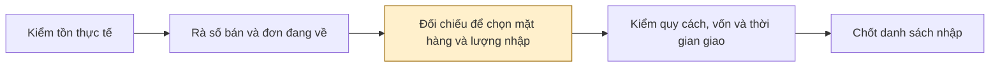
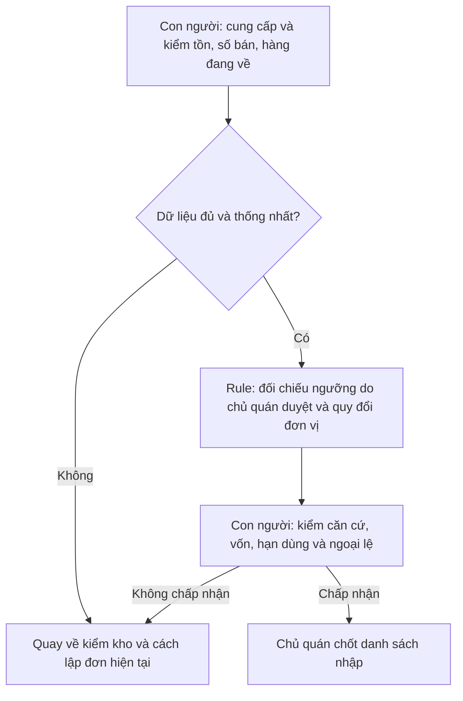

> Bản lưu của hướng tạp hóa trước khi chuyển sang quán bia; không phải báo cáo nhóm hiện tại.

# Báo cáo nhóm — Day 02 Discovery & Problem Framing

> Bài phân tích tình huống mô phỏng phục vụ buổi làm 120 phút. Số bán, tồn, thời gian và ngưỡng trong kịch bản là dữ liệu tổng hợp, không phải khảo sát thực tế. Research dùng nguồn công khai; CP3 và reflection chỉ ghi hoạt động thực sự diễn ra.
> Template chi tiết và prompt mẫu: [docs/01-worksheet.md](../../docs/01-worksheet.md). Bài mẫu: [docs/02-deliverable-example.md](../../docs/02-deliverable-example.md).

## 1. Thông tin nhóm

- Tên nhóm: ronaldo
- Thành viên: xem `TEAM.md`
- Hướng khảo sát hiện tại: Quyết định nhập hàng tại cửa hàng tạp hóa, nhằm hạn chế nhập dư hàng bán chậm và thiếu hàng bán chạy.
- Candidate nhóm chốt sau CP3: Chưa ghi nhận kết quả thảo luận.
- Kết luận phân tích: Rule đủ để tính thử trên kịch bản; Not Yet đối với triển khai thực tế vì chưa kiểm chứng. Nhóm chưa ghi kết quả chốt chung.
- Dữ liệu hiện có: quan sát của Nguyễn Lâm Hoàng tại cửa hàng tạp hóa về Hảo Hảo bán chạy hơn và Kokomi còn nhiều hơn; chưa có số bán/tồn, thời gian theo dõi hoặc phỏng vấn chủ quán.

---

## 2. Hội tụ nhóm (CP3)

### 2.1. Pitch

| # | Người đưa ra | Candidate (Job Story ngắn) | Actor | Bottleneck | Câu hỏi phản biện nhận được (ai hỏi) |
|---:|---|---|---|---|---|
| 1 | | | | | |
| 2 | | | | | |
| 3 | | | | | |
| 4 | | | | | |
| 5 | | | | | |
| 6 | | | | | |
| 7 | | | | | |
| 8 | | | | | |
| 9 | | | | | |
| 10 | | | | | |
| 11 | | | | | |
| 12 | | | | | |

### 2.2. Cluster

| Cluster | Các candidate | Pattern chung |
|---|---|---|
| A | | |
| B | | |
| C | | |

### 2.3. Opportunity Solution Tree rút gọn

Gốc là **1 outcome**. Nhánh là **opportunity** (nhu cầu, pain), không phải tính năng hay công cụ.

```text
OUTCOME: 
├── Opportunity A: 
├── Opportunity B: 
└── Opportunity C: 
```

Những ý đã gạch bỏ vì là solution đội lốt opportunity:

-

### 2.4. Chấm điểm shortlist (1–5)

| Candidate | Actor rõ | Quy trình rõ | Pain có bằng chứng | Impact đo được | Vừa sức lab | So sánh được No AI/Rule/Workflow/Agent | Nhóm hiểu domain | Tổng |
|---|---:|---:|---:|---:|---:|---:|---:|---:|
| | | | | | | | | |
| | | | | | | | | |
| | | | | | | | | |

**Candidate được chọn:**

**Vì sao chọn:**

**Vì sao loại các candidate còn lại:**

**Xử lý bất đồng (nếu có):**

---

## 3. Kiểm chứng + research giải pháp đã có (CP4)

### 3.1. Assumption Map

Điểm ưu tiên dự kiến: quan trọng 1–5; bằng chứng 1–5, trong đó 1 là chưa có bằng chứng trực tiếp tại cửa hàng.

| # | Giả định | Loại | Quan trọng | Đã có bằng chứng | Kiểm trước? |
|---:|---|---|---:|---:|---|
| 1 | Chủ cửa hàng gặp nhập dư hoặc thiếu hàng vì khó quyết định lượng nhập | Value | 5 | 1 | Có; cần một lần xảy ra cụ thể |
| 2 | Có số bán, tồn thực tế và đơn đang về đủ để đối chiếu | Feasibility | 5 | 1 | Có; kiểm tra dữ liệu trước khi chọn công cụ |
| 3 | Cảnh báo theo ngưỡng đơn giản giúp ích hơn cách hiện tại | Value | 4 | 1 | Có; cần đối chứng |
| 4 | Chủ cửa hàng hiểu và kiểm tra được căn cứ đề xuất | Usability | 4 | 1 | Có; quan sát họ giải thích lại |
| 5 | Công cập nhật dữ liệu không lớn hơn thời gian tiết kiệm | Viability | 5 | 1 | Có; tính cả nhập liệu và kiểm kho |
| 6 | Quy cách thùng/lốc, thời gian giao và hạn dùng không làm đề xuất mất khả thi | Feasibility | 4 | 1 | Kiểm cùng một đơn nhập thật |

### 3.2. Kiểm chứng

**Quan sát ban đầu:** Nguyễn Lâm Hoàng cho biết tại cửa hàng được quan sát, Hảo Hảo bán chạy hơn và Kokomi còn nhiều hơn. Chưa rõ số lượng, thời gian theo dõi, loại/vị/quy cách cụ thể hoặc lượng nhập của mỗi loại. Đây là quan sát tự thuật, chưa phải phỏng vấn CP4 hoặc bằng chứng nguyên nhân nhập dư.

Chưa thực hiện phỏng vấn/survey. Chưa ghi nhận Hảo Hảo từng hết hàng hay lượng Kokomi vượt mức tồn phù hợp.

**Kịch bản thay cho dữ liệu đầu vào của bài tập trên lớp:**

| Mã minh họa | Tồn đầu kỳ | Nhập trong kỳ | Bán 14 ngày | Tồn D0 | Đang về | Bán bình quân |
|---|---:|---:|---:|---:|---:|---:|
| HH01 — Hảo Hảo | 164 | 0 | 140 | 24 | 0 | 10 gói/ngày |
| KK01 — Kokomi | 112 | 0 | 28 | 84 | 0 | 2 gói/ngày |

Đơn vị: gói. Giả lập tiệm mở đủ 14 ngày và không hết hàng trong kỳ; không trả hàng hoặc thất thoát. Hai phương trình tồn đều khớp. Nhãn chỉ tham chiếu tình huống người học nêu; số liệu không mô tả một cửa hàng hoặc sản phẩm thực tế.

Giả lập giao trong 2 ngày, nhập theo thùng 30 gói và xem xét đơn mỗi ngày. HH01: Min 30, Max 84; KK01: Min 6, Max 30. Ngưỡng là chính sách thử, không phải tối ưu đã được chứng minh. Xem [kịch bản đầy đủ và 10 mẫu kiểm Rule](../assets/cp4-kich-ban-mo-phong-tap-hoa.md).

**Giới hạn CP4:** không có người tham gia hoặc câu trả lời phỏng vấn. Tính nhất quán của kịch bản không thay thế bằng chứng về hành vi người dùng theo đề gốc.

**Điều chỉnh phạm vi trong phân tích:** thu hẹp từ toàn bộ tạp hóa vào hai mã mì để kiểm cách đối chiếu tồn, số bán, quy cách và hàng đang về. Không coi đây là thay đổi sau phỏng vấn.

### 3.3. Research giải pháp đã có

Nguồn chính thức đã được mở bằng công cụ web ngày 09/11/2026; cần tự kiểm lại để đối chiếu với phiên bản cửa hàng dùng.

| Công cụ / pattern | Link | Bước được hỗ trợ | Điểm mạnh | Khoảng trống / rủi ro | Bài học |
|---|---|---|---|---|---|
| KiotViet: định mức tồn | [Hướng dẫn danh mục hàng hóa](https://www.kiotviet.vn/huong-dan-su-dung-kiotviet/salon-hang-hoa/danh-muc-hang-hoa/) | Theo dõi tồn và cảnh báo nhập | Có thiết lập tồn ít nhất/nhiều nhất | Nguồn thuộc phiên bản ngành làm đẹp; chưa xác nhận trên hệ thống bán lẻ của cửa hàng cụ thể | Cảnh báo ngưỡng đã có; kiểm công cụ hiện tại trước khi xây thêm |
| Sapo: báo cáo nhập hàng | [Tổng quan báo cáo nhập hàng](https://help.sapo.vn/tong-quan-bao-cao-nhap-hang) | Rà lịch nhập theo hàng, thời gian, nhà cung cấp | Phân biệt hàng nhập kho với thanh toán nhập hàng | Báo cáo nhập không tự chứng minh lượng cần nhập; cần thêm tồn, số bán và hàng đang về | Tận dụng dữ liệu sẵn có, không nhầm ngày thanh toán với ngày nhận hàng |

**Nhận định từ research:** bắt đầu bằng đối chiếu dữ liệu và Rule. Chưa có căn cứ để dùng AI dự đoán hoặc xây Agent. Đây là nhận định từ tài liệu, chưa chứng minh hiệu quả tại cửa hàng.

---

## 4. Quy trình trước/sau (CP5)

### 4.1. Quy trình hiện tại trong tình huống mô phỏng

Phạm vi tính thử: tiệm A, hai mã HH01 và KK01. Mở rộng thêm mã hàng là hướng sau bài tập, không dùng để suy ra thời gian xử lý hiện tại.



| Bước | Actor dự kiến | Input | Output | Thời gian / tần suất | Cần xác nhận |
|---:|---|---|---|---|---|
| 1 | Chủ quán / nhân viên | Hàng và sổ tồn trong kịch bản | Tồn theo mã, đơn vị, thời điểm | 5 phút mô phỏng | Kiểm cả kệ và kho |
| 2 | Chủ quán | Số bán 14 ngày, đơn chưa nhận | Bảng số bán và hàng đang về | 8 phút mô phỏng | Kịch bản chính không có đơn đang về |
| 3 | Chủ quán | Tồn, số bán và chính sách nhập | Danh sách lượng nhập | 12 phút mô phỏng | Bước dài nhất trong kịch bản |
| 4 | Chủ quán | Quy cách, vốn, hạn dùng, thời gian giao | Danh sách có thể duyệt | 6 phút mô phỏng | Giá vốn và hạn dùng chưa được lượng hóa |
| 5 | Chủ quán | Danh sách đã kiểm | Quyết định nhập | 4 phút mô phỏng | Tổng 5 bước: 35 phút |

**Bottleneck trong kịch bản:** bước 3, 12/35 phút, đối chiếu để quyết định lượng nhập. Các mốc là ngân sách thời gian mô phỏng, chưa có đo đạc tại quán.

### 4.2. Quy trình tương lai — phương án thử bằng Rule



- **Rule trong bài tập:** nếu tồn khả dụng < Min, tính Max − tồn khả dụng rồi làm tròn lên theo thùng 30 gói. Kiểm lịch đơn đang về, khả năng đủ hàng trước khi nhận và trường hợp vượt Max sau làm tròn. HH01 đề nghị 60 gói (2 thùng); KK01 không nhập, cảnh báo cao hơn Max 54 gói. Ngưỡng cần chủ quán xác nhận trước khi dùng thực tế.
- **Kiểm thời gian giao:** HH01 có 24 gói, nếu bán 10 gói/ngày thì sau 2 ngày còn 4; nhận 60 gói thành 64. Vị thế 24 + 60 = 84 ở ngày lập đơn không phải tồn thực lúc nhận.
- **Con người:** xác nhận dữ liệu, xử lý ngoại lệ, kiểm khả năng nhập và duyệt danh sách.
- **AI:** chưa có điểm can thiệp được chứng minh là cần thiết.
- **Boundary:** không tự đặt hàng, thanh toán, liên hệ nhà cung cấp hoặc sửa tồn gốc. Dữ liệu thiếu/mâu thuẫn phải hiện cảnh báo.
- **Phương án quay về:** dừng đề xuất cho mã lỗi, kiểm đếm và lập đơn theo cách hiện tại; không tự điền số còn thiếu.

### 4.3. Before / after

| Chỉ số | Trước | Sau dự kiến | Cách kiểm |
|---|---|---|---|
| Số bước chính | 5 bước mô phỏng | 4 bước chính và nhánh quay về | Số bước không phải mục tiêu chính |
| Tổng thời gian | 35 phút trong kịch bản | Mục tiêu ≤28 phút, giảm ít nhất 20% | Chưa có kết quả đạt mục tiêu; tính cả nhập liệu, kiểm và sửa |
| Bước thủ công | Chưa đo thực tế | Con người vẫn kiểm dữ liệu, duyệt và chốt | Ghi cả thao tác cập nhật phát sinh |
| Số ngày-mã hàng hết hàng | Chưa đo | Không tăng so với giai đoạn đối chiếu tương đương | Theo dõi các mã và khoảng thời gian thống nhất |
| Rủi ro mới | Chưa đánh giá | Ngưỡng không phù hợp, dữ liệu cũ, sai đơn vị, bỏ qua hàng đang về | Kiểm trước khi duyệt đơn |

Target 20% là mức thử đề xuất, không phải kết quả đạt được. Chưa thể kết luận hiệu quả bằng bảng này.

---

## 5. Problem Statement v0 (CP5) — dự thảo để kiểm chứng

| Trường | Nội dung |
|---|---|
| **Actor** | Chủ cửa hàng tạp hóa trực tiếp quyết định nhập cho một nhóm hàng đóng gói |
| **Quy trình** | Kiểm tồn → rà số bán và đơn đang về → chọn mã và lượng nhập → kiểm ràng buộc → chốt danh sách |
| **Bottleneck** | Trong kịch bản: đối chiếu và chọn lượng nhập mất 12/35 phút; chưa có bằng chứng về bottleneck thực tế |
| **Impact** | Trong kịch bản: HH01 còn 24 gói, tương ứng 2,4 ngày bán; KK01 còn 84 gói, tương ứng 42 ngày bán nếu giữ nhịp bình quân. Chưa quy đổi thành thiệt hại |
| **Success Metric** | Mốc tham chiếu mô phỏng 35 phút → mục tiêu ≤28 phút cho cùng hai mã; tính cả nhập liệu, kiểm và sửa. Chưa có baseline thực tế |
| **Boundary** | Chủ quán duyệt quyết định; công cụ không tự đặt hàng hoặc sửa tồn. Trường hợp thiếu dữ liệu quay về kiểm thủ công |

**Phản biện của AI:** metric chỉ đo thời gian có thể khuyến khích chốt nhanh nhưng nhập sai. Cần đo lỗi dữ liệu và thiếu hàng; số bán thấp trong ngày hết hàng không chứng minh nhu cầu thấp. Nhóm cần tự xem xét phản biện và chốt bản viết của mình.

---

## 6. Mức can thiệp AI (CP6) — so sánh dự thảo

### 6.1. Ma trận độ mơ hồ × độ phức tạp

Phần đối chiếu số liệu có độ mơ hồ thấp nếu đơn vị và quy tắc rõ. Quyết định lượng nhập có ngoại lệ về nhu cầu và ràng buộc cung ứng, nên chưa thể xếp chắc trước kiểm chứng. Phạm vi thử được giới hạn để giảm độ phức tạp; số bước nhiều không tự chứng minh cần Agent.

### 6.2. So sánh 4 mức

| Mức | Phương án | Đủ khi nào | Rủi ro | Đánh giá sơ bộ |
|---|---|---|---|---|
| **No AI** | Sổ theo dõi thống nhất và checklist trước khi nhập | Quy mô nhỏ, chủ quán đối chiếu nhanh, ít sai | Phải cập nhật đều | Đối chứng cần thử trước |
| **Rule** | Bảng công thức, quy đổi đơn vị và cảnh báo ngưỡng được duyệt | Có dữ liệu đủ, quy tắc rõ và đủ ngoại lệ được người kiểm xử lý | Dữ liệu sai hoặc ngưỡng lỗi vẫn cho kết quả sai | Phương án thử ưu tiên nếu No AI chưa đủ |
| **Workflow** | Rule tính số; AI hỗ trợ đọc ghi chú và giải thích; người duyệt | Có bước ngôn ngữ thực sự gây tốn công mà Rule chưa đáp ứng | Đọc sai, bịa giải thích, tăng công kiểm | Chưa có bằng chứng cần |
| **Agent** | Tự tìm thông tin và chọn bước tiếp theo | Chỉ cân nhắc khi có nhu cầu hành động không thể định sẵn | Sai hành động và phát sinh quyền truy cập | Chưa có lý do chọn |

**Mức chọn cho tình huống mô phỏng: Rule.** Checklist No AI vẫn làm đối chứng về công sức; chưa có phép đo chứng minh Rule nhanh hơn.

**Vì sao chưa chọn mức cao hơn:** phần đối chiếu và tính toán cần đúng số, đúng đơn vị và truy được căn cứ. Chưa có bước đòi hỏi AI tự chọn hành động. Nếu checklist đã đủ hiệu quả thì dừng ở No AI.

### 6.3. AI Canvas

Chưa áp dụng vì phương án hiện ưu tiên No AI/Rule. Nếu kiểm chứng cho thấy cần AI, bổ sung Canvas từ dữ liệu và bước can thiệp thực tế.

### 6.4. Hai câu hỏi PAIR

Không bắt buộc với No AI/Rule. Chưa có bằng chứng để khẳng định chủ quán muốn giao hẳn việc; trong phương án thử, chủ quán vẫn duyệt mọi quyết định.

---

## 7. Problem Statement v1 + tiêu chí đánh giá (CP6) — dự thảo

| Trường | Nội dung |
|---|---|
| **Actor** | Chủ cửa hàng tạp hóa trực tiếp quyết định nhập một nhóm hàng đóng gói, có dữ liệu đủ để đối chiếu |
| **Quy trình** | Kiểm dữ liệu → đối chiếu và cảnh báo → chủ quán rà ràng buộc, ngoại lệ → chốt danh sách |
| **Bottleneck** | Đối chiếu dữ liệu và chọn lượng nhập: 12/35 phút trong kịch bản |
| **Impact** | Tham chiếu mô phỏng: 35 phút lập đơn; tồn HH01 tương đương 2,4 ngày bán, KK01 42 ngày. Chưa xác định tổn thất thực tế |
| **Success Metric** | Mốc mô phỏng 35 phút → mục tiêu ≤28 phút. Đạt 10/10 mẫu Rule, không bỏ qua dữ liệu thiếu hoặc sai đơn vị. Khi thử thực tế cần thêm metric ngày-mã hàng hết hàng; hiện chưa có kết quả vận hành |
| **Boundary** | Không tự đặt hàng, thanh toán, sửa tồn hoặc tự điền dữ liệu thiếu. Không khẳng định nhu cầu bằng doanh số quan sát khi có hết hàng |
| **AI intervention point** | Không có trong phương án thử No AI/Rule |
| **Mức chọn** | Rule trong kịch bản; chưa phải quyết định triển khai thực tế |
| **Rủi ro & người kiểm tra** | Chủ quán kiểm tồn, đơn vị, hàng đang về và khả năng nhập; nhóm ghi nhận lỗi và thời gian để đánh giá |

**Thay đổi dự thảo so với v0:**

| Trường | v0 | v1 | Vì sao đổi |
|---|---|---|---|
| Actor | Chủ quán trực tiếp quyết định nhập | Bổ sung điều kiện dữ liệu đủ | Tránh đưa đề xuất khi chưa có đầu vào kiểm được |
| Success Metric | Chủ yếu đo thời gian | Thêm kiểm soát thiếu hàng và lỗi dữ liệu | Nhanh hơn chưa đủ chứng minh quyết định tốt hơn |
| Can thiệp | Chưa xác định | Ưu tiên đối chứng No AI/Rule | Research cho thấy công cụ theo ngưỡng đã có; chưa có bằng chứng cần AI |

**Tiêu chí đánh giá giải pháp không dùng AI:**

| # | Tiêu chí | Đạt | Không đạt |
|---:|---|---|---|
| 1 | Truy được căn cứ | Mỗi cảnh báo có nguồn tồn, thời điểm và ngưỡng | Có số không truy được nguồn |
| 2 | Đúng đơn vị và tính toán | Quy đổi lốc/thùng/đơn vị bán theo thông tin đã xác nhận | Trộn đơn vị, tính sai hoặc làm tròn không nêu quy tắc |
| 3 | Có xét hàng đang về | Đơn chưa nhận được hiển thị; không đếm lại hàng đã nhận | Bỏ sót hoặc tính trùng đơn |
| 4 | Dữ liệu thiếu được nhận diện | Chặn đề xuất không đủ căn cứ và yêu cầu kiểm tra | Tự đoán số thiếu hoặc dùng dữ liệu cũ không cảnh báo |
| 5 | Giữ quyền duyệt | Chủ quán xem căn cứ và chốt; có đường quay về | Công cụ tự đặt đơn hoặc thay đổi dữ liệu gốc |

---

## 8. Quyết định (CP6) — đánh giá sơ bộ

### 8.1. Bốn rủi ro

| Rủi ro | Mức sơ bộ | Lý do |
|---|---|---|
| **Value** | Cao | Chưa có người dùng hoặc tình huống nhập dư/thiếu đã kiểm chứng |
| **Usability** | Trung bình | Bảng đơn giản có thể dễ dùng nhưng chưa quan sát chủ quán sử dụng |
| **Feasibility** | Cao | Chưa xác nhận có số bán, tồn đúng, đơn đang về và quy đổi đơn vị |
| **Viability** | Trung bình | Chưa biết quyền chia sẻ dữ liệu, người cập nhật và tổng công vận hành |

### 8.2. Kết luận dự thảo

**Kết luận phân tích: Rule đủ cho phép tính của kịch bản; Not Yet đối với triển khai thực tế.** Mô phỏng giúp kiểm logic, chưa chứng minh chủ quán cần hoặc dùng được giải pháp. Không chuyển kết quả này thành Go kinh doanh.

**Bước tiếp theo:** xác nhận cửa hàng và nhóm hàng; hoàn thành kiểm chứng với người thật; đo một chu trình lập đơn hiện tại; xác định thời gian giao, quy cách và chất lượng dữ liệu. Sau đó sửa quy trình và metric.

**Pilot nếu đủ điều kiện:** thử trên một nhóm hàng trong hai chu kỳ nhập, có chủ quán duyệt, so với checklist hiện tại. Hai chu kỳ là phạm vi khởi đầu, không đủ khẳng định hiệu quả dài hạn hoặc biến động mùa vụ.

**Ngưỡng dừng đề xuất:**

- Có một đề xuất dùng sai đơn vị, sai tồn hoặc bỏ qua đơn đang về mà không được phát hiện ở bước kiểm → tạm dừng, đối soát và quay về cách hiện tại.
- Sau hai chu kỳ, tổng thời gian tính cả nhập và sửa dữ liệu không giảm ít nhất 20% → không mở rộng; xem lại Rule hoặc dùng checklist.
- Dữ liệu không đủ phân biệt bán thấp với hết hàng, hoặc không được phép dùng → không tạo đề xuất nhập cho trường hợp đó.

---

## 9. Hạn chế và hướng tiếp theo

Bài tập dùng hai mã và nhu cầu ổn định, không có khuyến mãi, ngày hết hàng hoặc biến động giao trong bộ chính. Số lượng, thời gian và ngưỡng là mô phỏng. Chưa có kiểm chứng người thật, đo hiệu quả hoặc kết quả hội tụ nhóm. Không coi mẫu này là hoàn thành phần kiểm chứng CP4 của đề gốc; không suy ra doanh thu mất hoặc hiệu quả giảm tồn.

## 10. Tài liệu tham khảo

- [KiotViet — Danh mục hàng hóa](https://www.kiotviet.vn/huong-dan-su-dung-kiotviet/salon-hang-hoa/danh-muc-hang-hoa/).
- [Sapo — Tổng quan báo cáo nhập hàng](https://help.sapo.vn/tong-quan-bao-cao-nhap-hang).
- [Ghi chú research và dữ liệu cần thu thập](../assets/cp4-research-ton-kho-tap-hoa.md).

- [Kịch bản số liệu, 10 mẫu Rule và lịch làm 120 phút](../assets/cp4-kich-ban-mo-phong-tap-hoa.md).
