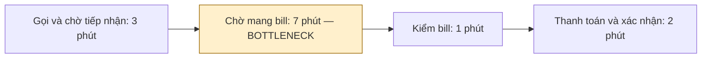

# Báo cáo cá nhân — Nguyễn Lâm Hoàng

> CP1 dùng 5 trải nghiệm cá nhân với số liệu tự thuật. CP2 bổ sung phân bổ thời gian mô phỏng để phân tích trên lớp; không coi đó là số đo thực tế.

## 1. Thông tin học viên

- Họ tên: Nguyễn Lâm Hoàng
- MSSV: 2A202603448
- Email trường (không bắt buộc, repo có thể để public):
- Tên nhóm: ronaldo
- Link repo hiện tại: https://github.com/hoangnguyenai/K5-L3A-Day02-NguyenLamhHoang-2A202603448-DiscoveryProblemFraming

---

## 2. Scan problem (CP1)

Lăng kính: **Lặp lại** · **Tốn thời gian** · **Cần đọc, tổng hợp nhiều thông tin** · **Pain từ người khác**.

| # | Lăng kính | Job Story: Khi… tôi muốn… để… | Ai chịu ảnh hưởng? | Dấu hiệu thật (thời gian, tần suất, số người, bằng chứng) |
|---:|---|---|---|---|
| 1 | Lặp lại · Tốn thời gian | Khi đi lại lúc 7h30–8h30 hoặc 17h–18h30, tôi muốn dự trù thời gian di chuyển sát thực tế, để đến nơi đúng giờ dù đường ùn tắc. | Tôi khi đi lại | Tự thuật: mất thêm khoảng 20–40 phút/lần, 3–5 lần/tuần; thường khó hơn khi mưa. Đang đi sớm, đổi tuyến hoặc xem Google Maps. Chưa có log chuyến đi. |
| 2 | Lặp lại · Tốn thời gian | Khi ăn xong ở quán vào giờ trưa, tối hoặc cuối tuần, tôi muốn hoàn tất kiểm tra hóa đơn và thanh toán sớm, để chủ động rời quán cho việc tiếp theo. | Tôi khi ăn tại quán | Tự thuật: chờ 5–15 phút/lần, 2–3 lần/tuần; gọi nhân viên nhiều lần hoặc đợi tại bàn. Lần được kể cụ thể: quán bia, 9 người, khoảng 19h30 tối thứ Bảy; chờ 10–15 phút tính từ lần đầu gọi tính tiền, chưa rõ mốc kết thúc. Sau đó một người ứng tiền, tự chia và nhắc chuyển khoản. |
| 3 | Lặp lại · Tốn thời gian | Khi cần đặt xe buổi sáng hoặc tối muộn, tôi muốn biết sớm có thể tìm được chuyến phù hợp không, để quyết định cách di chuyển và tránh đặt lại nhiều lần. | Tôi khi gọi xe | Tự thuật: mất 10–25 phút/lần, 2–4 lần/tuần; gặp hủy chuyến, chờ nhận chuyến hoặc giá tăng; đang đặt lại hoặc chuyển ứng dụng. Chưa có lịch sử chuyến để kiểm. |
| 4 | Tốn thời gian | Khi đặt đồ ăn giờ trưa trong ngày bận học hoặc làm việc, tôi muốn biết đơn đang vướng ở bước nào và thời gian giao có thay đổi không, để sắp xếp giờ ăn mà không kiểm tra liên tục. | Tôi khi đặt đồ ăn | Tự thuật: chờ thêm 15–30 phút so với dự kiến; thường xem trạng thái, nhắn hoặc gọi shipper. Chưa có tần suất cụ thể. Nhà hàng chuẩn bị chậm, khó tìm địa chỉ và giao nhiều đơn là các nguyên nhân được tôi nêu, chưa có log xác nhận từng nguyên nhân. |
| 5 | Tốn thời gian | Khi đến làm giấy tờ hoặc xin xác nhận, tôi muốn biết hồ sơ cần gì và còn phải chờ những bước nào, để hạn chế bổ sung giấy tờ và chủ động thời gian cá nhân. | Tôi khi làm thủ tục hành chính | Tự thuật: 30 phút đến 2 giờ/lần; lấy số, chờ lượt và có thể phải bổ sung hồ sơ. Đang đến sớm và chuẩn bị giấy tờ. Chưa tách thời gian chờ và xử lý. |

**Nguồn:** 5 trải nghiệm cá nhân do tôi cung cấp; thời gian là ước lượng, chưa phải số đo bằng đồng hồ.

**Dùng AI khi scan:** Hỗ trợ diễn đạt Job Story từ mô tả của tôi.

**Ý tưởng bổ sung đã cân nhắc:** quản lý nhập hàng tạp hóa và tìm thực tập phù hợp. Hai hướng được giữ làm tham khảo; hướng đang phát triển là chờ tính tiền tại quán bia.

---

## 3. Top 3 Problem Cards + quy trình nháp (CP2)

> Các tình huống xuất phát từ CP1. Phân bổ phút từng bước bên dưới là mô phỏng để hoàn thiện phân tích trên lớp, không phải số đo hoặc chi tiết đã được xác nhận của các lần thực tế. Target là mục tiêu đề xuất, chưa có kết quả đạt được.

### Bảng chọn top 3

| Rank | Problem | Vì sao chọn | Điều cần kiểm chứng |
|---:|---|---|---|
| 1 | Chờ tính tiền tại quán bia | Có tình huống 9 người, khoảng 19h30 tối thứ Bảy và hành vi gọi nhắc cụ thể | Chậm ở tiếp nhận hay lập/mang bill; mốc cuối khoảng chờ tự thuật |
| 2 | Chờ đồ ăn vượt dự kiến | Có độ trễ tự thuật 15–30 phút và hành vi xem trạng thái, liên hệ shipper | Nguyên nhân chậm và công sức kiểm tra |
| 3 | Chờ làm thủ tục hành chính | Có khoảng thời gian tự thuật 30–120 phút, quy trình có thể mô tả | Loại thủ tục, giấy tờ và phần thời gian thực sự có thể giảm |

### Problem Card #1 — Chờ tính tiền tại quán bia

| Trường | Nội dung |
|---|---|
| Job Story | Khi ăn uống xong cùng nhóm 9 người tại quán bia đông khách vào tối thứ Bảy, tôi muốn yêu cầu tính tiền được tiếp nhận và nhận bill sớm, để chủ động kết thúc buổi gặp. |
| Actor | Khách ăn uống theo nhóm; nhân viên phục vụ và thu ngân là actor phối hợp. |
| Thời điểm / bối cảnh | Trải nghiệm kể lại: khoảng 19h30 tối thứ Bảy, quán đông, phải gọi nhân viên vài lần. |
| Quy trình hiện tại (3–7 bước) | Mô phỏng 4 bước: gọi/chờ tiếp nhận 3 phút → chờ mang bill 7 phút → kiểm bill 1 phút → thanh toán và xác nhận 2 phút. Tổng 13 phút. |
| Bottleneck | Trong mô phỏng: chờ mang bill 7 phút; tổng từ lần gọi đầu đến nhận bill là 10 phút. Trải nghiệm thật mới chỉ xác định vùng chờ gồm tiếp nhận và mang bill. |
| Impact | Phải gọi nhắc và khó chủ động rời quán. Khoảng chờ thực tế tự thuật là 10–15 phút nhưng mốc cuối chưa rõ; không đồng nhất với tổng mô phỏng 13 phút. |
| Success metric | Mốc mô phỏng từ yêu cầu đầu → nhận bill: 10 phút → target ≤5 phút. Ghi giờ ở hai mốc cho mỗi lượt thử; đếm số lần gọi nhắc và bill cần sửa, không để chất lượng bill xấu đi. |
| Phương án không dùng AI | Phân công người nhận yêu cầu tính tiền, ghi mã bàn và trạng thái xử lý; kiểm bill trước khi đưa khách. |
| Giả thuyết về AI | Chưa cần AI cho yêu cầu và trạng thái rõ. Nếu việc theo dõi nhiều bàn vượt khả năng checklist thì cân nhắc Rule trước. |
| Cảm nhận nhanh | No AI; Rule là phương án tiếp theo có điều kiện. |



Thời gian là mô phỏng; tổng 13 phút, trong đó metric chính kết thúc khi nhận bill ở phút thứ 10. Chia tiền và nhắc chuyển khoản sau bữa là pain phụ, không cộng vào metric này.

### Problem Card #2 — Chờ đồ ăn vượt dự kiến

| Trường | Nội dung |
|---|---|
| Job Story | Khi đặt đồ ăn giờ trưa trong ngày bận học hoặc làm việc, tôi muốn biết đơn đang ở bước nào và có chậm không, để sắp xếp giờ ăn mà không kiểm tra liên tục. |
| Actor | Người đặt đồ ăn; nhà hàng và người giao là actor phối hợp. |
| Thời điểm / bối cảnh | Giờ trưa, trong ngày bận. Trải nghiệm tự thuật chờ thêm 15–30 phút so với dự kiến. |
| Quy trình hiện tại (3–7 bước) | Mô phỏng: đặt đơn 2 phút → chờ thụ động 30 phút → các khoảng kiểm trạng thái/liên hệ tổng 5 phút → nhận đồ 3 phút. Tổng 40 phút, các khoảng không chồng nhau. |
| Bottleneck | Chờ thụ động 30 phút là phần dài nhất, phụ thuộc nhà hàng và giao hàng. Phần có thể cải tiến trực tiếp phía người dùng là 5 phút chủ động kiểm tra/liên hệ. |
| Impact | Bị gián đoạn khi học/làm và khó sắp xếp giờ ăn. Chưa có dữ liệu xác nhận nguyên nhân chậm từng đơn. |
| Success metric | Mốc mô phỏng công chủ động kiểm tra/liên hệ 5 phút/đơn → target ≤2 phút/đơn. Ghi tổng thời gian thao tác và số lần mở trạng thái/gọi; không cam kết giảm thời gian giao 40 phút chỉ bằng giảm thao tác kiểm tra. |
| Phương án không dùng AI | Kiểm tra địa chỉ và hướng dẫn nhận; tận dụng thông báo trạng thái sẵn có, chỉ liên hệ khi có dấu hiệu cần xử lý. |
| Giả thuyết về AI | Chưa có bằng chứng cần AI; cải thiện thông tin và Rule thông báo có thể đủ. |
| Cảm nhận nhanh | No AI/Rule; không đề xuất Agent. |

```text
[Đặt đơn: 2 phút] → [Chờ thụ động: 30 phút — BOTTLENECK]
→ [Các lần kiểm tra/liên hệ: tổng 5 phút] → [Nhận đồ: 3 phút]
Tổng mô phỏng: 40 phút. Các lần kiểm tra có thể xen kẽ lúc chờ;
30 phút chỉ tính phần chờ không thao tác, tránh cộng trùng.
```

### Problem Card #3 — Chờ làm thủ tục hành chính

| Trường | Nội dung |
|---|---|
| Job Story | Khi làm giấy tờ hoặc xin xác nhận, tôi muốn biết hồ sơ cần gì và những bước phải chờ, để hạn chế bổ sung giấy tờ và chủ động thời gian. |
| Actor | Người đến làm thủ tục; nhân viên tiếp nhận là actor phối hợp. |
| Thời điểm / bối cảnh | Cần giấy tờ/xác nhận; chưa chọn một thủ tục thực tế cụ thể. Kịch bản dưới xét bổ sung giấy tờ tại chỗ. |
| Quy trình hiện tại (3–7 bước) | Mô phỏng: chuẩn bị 5 phút → lấy số 2 phút → chờ lượt 38 phút → xử lý tại quầy 10 phút → bổ sung tại chỗ 5 phút. Tổng 60 phút. |
| Bottleneck | Chờ lượt 38 phút dài nhất nhưng không nằm trong quyền kiểm soát của người nộp. Nhánh bổ sung 5 phút là phần thử giảm bằng chuẩn bị hồ sơ. |
| Impact | Khó chủ động thời gian và phát sinh thao tác bổ sung. Tổng tự thuật 30–120 phút chưa được tách theo bước; mô phỏng không thay số đo này. |
| Success metric | Trong mô phỏng: một lần bổ sung → target 0 lần. Cho phép chuẩn bị tăng từ 5 lên 8 phút; giữ thời gian khác cố định thì tổng 60 → 58 phút. Đo toàn hành trình từ chuẩn bị đến hoàn tất, đếm lần bổ sung; không hứa giảm hàng đợi bằng checklist. |
| Phương án không dùng AI | Checklist lấy từ hướng dẫn chính thức đúng thủ tục, tự đối chiếu giấy tờ trước khi đến. |
| Giả thuyết về AI | Chưa cần AI nếu danh mục giấy tờ rõ; không dùng AI tự kết luận hồ sơ hợp lệ. |
| Cảm nhận nhanh | No AI; thu hẹp thủ tục trước khi phát triển thêm. |

```text
[Chuẩn bị: 5 phút] → [Lấy số: 2 phút]
→ [Chờ lượt: 38 phút — BOTTLENECK] → [Xử lý tại quầy: 10 phút]
→ [Bổ sung tại chỗ: 5 phút]
Tổng mô phỏng: 60 phút.
Target: chuẩn bị 8 phút, bỏ bước bổ sung → 8 + 2 + 38 + 10 = 58 phút.
```

### Card muốn pitch nhất

- Card số: 1 — Chờ tính tiền tại quán bia.
- Vì sao: Có trải nghiệm cụ thể, actor rõ và vùng chờ đã được nhận diện; phạm vi từ yêu cầu đến nhận bill đủ nhỏ để phân tích.
- Câu hỏi muốn nhóm phản biện: Nếu chỉ phân công một người tiếp nhận và theo dõi yêu cầu theo bàn thì đã đủ chưa, hay bottleneck thực sự nằm ở khâu lập bill?

### Phản biện của AI và nội dung đã bổ sung

| Điểm yếu AI chỉ ra | Phản hồi / căn cứ | Điều chỉnh trong bản nháp |
|---|---|---|
| Khoảng chờ chưa có bối cảnh và mốc rõ | Tôi bổ sung lần đi quán bia 9 người, khoảng 19h30 tối thứ Bảy | Tách thời gian tự thuật với phân bổ mô phỏng; metric đề xuất có mốc yêu cầu và nhận bill |
| Chờ bill khác chia/thu lại tiền | Cả hai xuất hiện trong mô tả trải nghiệm | Giới hạn card 1 ở chờ bill; chia tiền giữ là pain phụ |
| Giảm kiểm tra đơn không đồng nghĩa giao nhanh hơn | Thời gian vận chuyển ngoài quyền kiểm soát của người đặt | Card 2 đo công thao tác chủ động, không cam kết giảm thời gian giao |
| Checklist không làm hàng đợi hành chính ngắn hơn | Chờ lượt và bổ sung là hai bước khác nhau | Card 3 giữ thời gian chờ, tính cả công chuẩn bị tăng thêm để tránh thổi phồng hiệu quả |

---

## 4. Tôi đã tham gia phần nào (CP3 → CP7)

| Hoạt động | Tôi đã làm gì? | Kết quả / ảnh hưởng tới bài nhóm |
|---|---|---|
| Pitch Problem Card với nhóm | Chưa có nhật ký thực hiện | Chưa có kết quả |
| Phản biện bài của bạn khác | Chưa có câu hỏi thực tế được cung cấp | Chưa có kết quả |
| Nhận phản biện từ AI | Cần phân biệt chờ nhận bill với chia tiền sau bữa; khoảng 10–15 phút chưa có mốc cuối | Bổ sung quán bia, 9 người và bối cảnh 19h30 tối thứ Bảy; bản nháp tách quan sát với mô phỏng |
| Gom cluster / cây OST | | |
| Chọn hướng phát triển cá nhân | Chọn lại chờ thanh toán tại quán bia sau khi cân nhắc tạp hóa và thực tập | Giữ vấn đề có trải nghiệm trực tiếp; chưa phải kết quả hội tụ nhóm |
| Kiểm chứng / research | | |
| Quy trình nhóm | | |
| Problem Statement | | |
| Mức can thiệp AI | | |
| Quyết định | | |

---

## 5. Dùng AI

| Checkpoint | Tôi dùng AI để làm gì? | AI hữu ích ở đâu? | AI sai hoặc hời hợt ở đâu? | Tôi sửa gì bằng nhận định của mình? |
|---|---|---|---|---|
| CP1 Scan | Diễn đạt Job Story từ trải nghiệm | Làm rõ bối cảnh và kết quả mong muốn | Một số gợi ý chưa có trải nghiệm trực tiếp | Chọn lại hướng chờ thanh toán tại quán bia |
| CP2 Problem Card | Sắp xếp card, phản biện, vẽ quy trình và mô phỏng thời gian | Làm rõ metric và giới hạn can thiệp | Phân bổ phút không phải số đo thực tế | Tôi cung cấp tình huống quán bia; bản nháp tách dữ liệu kể lại với mô phỏng |
| CP4 Research | Tìm giải pháp liên quan thanh toán tại quán | Tổng hợp Toast, iPOS, KiotViet và nguồn | QR thanh toán chưa chắc giảm bước chờ bill | Thu hẹp bài toán vào tiếp nhận yêu cầu tính tiền và nhận bill |
| CP5–CP6 | Hỗ trợ soạn dự thảo, phản biện metric, sơ đồ và tình huống kiểm | Giúp đồng bộ phạm vi yêu cầu → nhận bill | Mốc mô phỏng chưa chứng minh hiệu quả thực tế | Tôi xác nhận chọn hướng quán bia; phần chốt tập thể còn chờ |

---

## 6. Reflection (CP7)

Trả lời bằng trải nghiệm thật của bạn, tối thiểu 200 từ cho các câu 6.1–6.6 (không tính 6.7, câu này được chấm riêng ở tiêu chí C5). **Không dùng AI để viết thay.**

**6.1. Tôi học được gì khi nghe top 3 problems của các bạn khác?**

**6.2. Nhóm có lúc nào bị "solution-first" (nghĩ giải pháp trước khi hiểu vấn đề) không? Lúc đó nhóm nhận ra và xử lý thế nào?**

**6.3. Tôi có đổi ý sau khi bị phản biện không? Kể một lần cụ thể.**

**6.4. Kết quả kiểm chứng (phỏng vấn/survey/research) có làm tôi bất ngờ không? Điều gì?**

**6.5. Điều khó nhất khi viết Problem Statement là gì?**

**6.6. Nếu làm lại, tôi sẽ đổi gì? Tôi sẽ phản biện nhóm mạnh hơn ở điểm nào?**

**6.7. Hiểu bài:** giải thích bằng 5–8 câu, không nhìn tài liệu, chuỗi *problem → quy trình → metric → boundary → mức can thiệp AI → quyết định* của bài nhóm mình.

---

## 7. Tài liệu tham khảo

- [Ghi chép trải nghiệm cá nhân](../assets/cp1-trai-nghiem-goc.md).
- [Research về chờ thanh toán — hướng hiện tại](../assets/cp4-research-thanh-toan.md).
- [Research tạp hóa — hướng tham khảo trước đó](../assets/cp4-research-ton-kho-tap-hoa.md).
