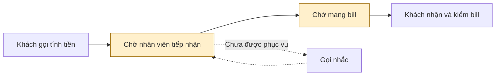
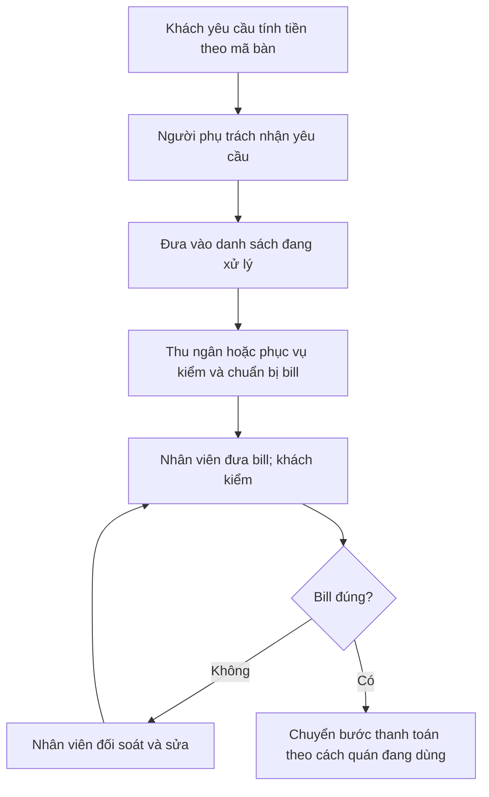

# Báo cáo nhóm — Day 02 Discovery & Problem Framing

> Hướng hiện tại: chờ tính tiền tại quán bia. Trải nghiệm tự thuật, nguồn research và phương án thiết kế được phân biệt rõ; chưa có phỏng vấn/survey hoặc kết quả tập thể. Bản này là dự thảo để nhóm thảo luận và chốt.

## 1. Thông tin nhóm

- Tên nhóm: ronaldo.
- Thành viên: xem [TEAM.md](../../TEAM.md).
- Hướng do Nguyễn Lâm Hoàng chọn: giảm thời gian từ lúc khách yêu cầu tính tiền đến khi nhận bill tại quán bia đông khách.
- Candidate sau hội tụ nhóm: chờ CP3.
- Đánh giá sơ bộ: Not Yet đối với triển khai thực tế; thử checklist trước khi thêm Rule.
- Dữ liệu: một trải nghiệm cá nhân tại quán bia, nhóm 9 người, khoảng 19h30 tối thứ Bảy; chưa có nguồn kiểm chứng bên ngoài nhóm.

---

## 2. Hội tụ nhóm (CP3) — phân tích chuẩn bị

> Bảng dưới sắp xếp ba candidate của Nguyễn Lâm Hoàng để nhóm dùng khi thảo luận. Đây là phân tích mẫu, không phải biên bản pitch, phản biện hoặc đồng thuận đã diễn ra. Chưa có candidate của các thành viên khác.

### 2.1. Candidate để pitch

| # | Nguồn candidate | Candidate (Job Story ngắn) | Actor | Bottleneck cần kiểm | Câu hỏi dự kiến để nhóm tự thảo luận |
|---:|---|---|---|---|---|
| 1 | Trải nghiệm Nguyễn Lâm Hoàng | Khi kết thúc bữa tại quán bia đông khách, muốn nhận bill sớm để chủ động rời quán | Khách theo nhóm | Chờ tiếp nhận và mang bill | Chậm do tiếp nhận, lập bill hay thiếu nhân viên? |
| 2 | Trải nghiệm Nguyễn Lâm Hoàng | Khi đồ ăn chậm, muốn biết trạng thái để không phải kiểm tra liên tục | Người đặt đồ ăn | Chờ giao; công kiểm tra/liên hệ | Cải tiến thông tin giảm công hay thực sự giảm thời gian giao? |
| 3 | Trải nghiệm Nguyễn Lâm Hoàng | Khi làm giấy tờ, muốn chuẩn bị đủ và biết bước chờ | Người làm thủ tục | Chờ lượt và bổ sung hồ sơ | Người dùng có thể cải thiện bước nào trong phạm vi kiểm soát? |

**Nhật ký thực tế:** chưa có người nghe pitch, câu hỏi nhận được hoặc ý kiến thành viên khác. Nhóm ghi bổ sung sau khi thực hiện, không coi câu hỏi dự kiến là lời một thành viên đã nói.

### 2.2. Cluster dự kiến

| Cluster | Candidate liên quan | Pattern chung |
|---|---|---|
| A — Chờ phục vụ | Tính tiền, giao đồ ăn, thủ tục | Phụ thuộc người khác xử lý và không rõ tiến độ |
| B — Công theo dõi | Gọi nhắc nhân viên, mở trạng thái/liên hệ shipper | Người dùng phải kiểm tra lặp lại |
| C — Sai sót và làm lại | Kiểm/sửa bill, bổ sung hồ sơ | Đầu vào hoặc xác nhận chưa đủ rõ |

### 2.3. Opportunity Solution Tree rút gọn

Cây mẫu cho hướng quán bia; các nhánh là pain cần kiểm chứng, chưa khẳng định nguyên nhân đã xác nhận.

```text
OUTCOME: Rút ngắn thời gian yêu cầu tính tiền → nhận bill, giữ bill đúng
├── Opportunity: Khách chưa biết yêu cầu đã được ai tiếp nhận
├── Opportunity: Khách chờ bill nhưng không biết tiến độ
└── Opportunity: Khách phải gọi nhắc nhiều lần
```

Các ý không đặt ở tầng opportunity: “làm app”, “gắn QR”, “chatbot tính tiền”. Đây là phương án giải quyết, chưa phải pain.

### 2.4. Chấm điểm shortlist — điểm minh họa

Điểm 1–5 là đánh giá mẫu để làm rõ lựa chọn, không phải điểm do các thành viên đã thống nhất.

| Candidate | Actor rõ | Quy trình rõ | Pain có bằng chứng | Impact đo được | Vừa sức lab | So sánh được 4 mức | Hiểu domain | Tổng |
|---|---:|---:|---:|---:|---:|---:|---:|---:|
| Chờ tính tiền tại quán bia | 5 | 5 | 3 | 4 | 5 | 5 | 4 | 31 |
| Theo dõi đơn đồ ăn chậm | 5 | 4 | 3 | 3 | 3 | 4 | 3 | 25 |
| Chờ thủ tục hành chính | 4 | 3 | 3 | 3 | 3 | 3 | 2 | 21 |

**Hướng cá nhân đã chọn:** chờ tính tiền tại quán bia. **Kết quả tập thể:** chưa có biên bản xác nhận.

**Lập luận lựa chọn:** có tình huống cụ thể với 9 người và hành vi gọi nhắc, ranh giới yêu cầu → nhận bill rõ, có thể thử một thay đổi nhỏ về trách nhiệm tiếp nhận.

**Hai candidate chưa ưu tiên:** giao đồ ăn có nhiều tác nhân ngoài phạm vi can thiệp, dễ nhầm giảm thao tác với giao nhanh hơn; thủ tục hành chính chưa xác định một thủ tục cụ thể và khó tác động vào hàng đợi.

**Xử lý bất đồng:** chưa có thông tin về bất đồng thực tế; không ghi nhận việc nhóm đã đồng thuận.

---

## 3. Kiểm chứng + research giải pháp đã có (CP4)

### 3.1. Assumption Map

Điểm 1–5: quan trọng càng cao càng cần kiểm; bằng chứng 1 là chưa có bằng chứng trực tiếp, 2 là chỉ có tự thuật của một người. Điểm là đánh giá dự thảo.

| # | Giả định | Loại | Quan trọng | Bằng chứng | Ưu tiên |
|---:|---|---|---:|---:|---|
| 1 | Chờ tiếp nhận và mang bill gây bất tiện đáng giải quyết | Value | 5 | 2 | Cao; mới có một trải nghiệm |
| 2 | Yêu cầu bị chậm do chưa có người nhận/xử lý rõ | Feasibility | 5 | 1 | Cao; chưa quan sát phía quán |
| 3 | Người nhận yêu cầu và hàng đợi theo bàn giúp giảm gọi nhắc | Value | 4 | 1 | So sánh với cách hiện tại |
| 4 | Nhân viên cập nhật trạng thái đủ nhanh trong giờ đông | Usability | 5 | 1 | Tính cả công cập nhật |
| 5 | Có mã bàn và dữ liệu bill đáng tin để theo dõi | Feasibility | 4 | 1 | Kiểm hệ thống quán |
| 6 | Quán chấp nhận thử và có người phụ trách vận hành | Viability | 4 | 1 | Xác nhận trước thử thực tế |

### 3.2. Bằng chứng hiện có

| Trường | Nội dung tự thuật |
|---|---|
| Nguồn | Nguyễn Lâm Hoàng, thành viên nhóm, kể trong chat; không tính là phỏng vấn CP4 |
| Bối cảnh | Quán bia, 9 người, khoảng 19h30 tối thứ Bảy; chưa có ngày lịch cụ thể |
| Hành vi | Gọi nhân viên vài lần; đợi bill, kiểm bill, yêu cầu chia tiền; một người trả trước rồi tính và nhắc chuyển khoản |
| Khoảng chờ | 10–15 phút từ lần gọi tính tiền đầu tiên; chưa xác nhận mốc kết thúc |
| Vùng chờ được chỉ ra | Gọi được nhân viên tiếp nhận yêu cầu và chờ nhân viên mang bill |
| Cách xử lý hiện tại | Gọi nhắc hoặc đợi tại bàn |
| Giới hạn | Chưa biết quán dùng POS hay ghi tay, công việc phía quán, thời gian từng bước và khách khác có cùng trải nghiệm không |

**Tín hiệu phản bác cần tìm, chưa phải kết quả đã thu được:** khách nhận bill nhanh ở quán khác; nghẽn thực sự do sai món, đổi bill hoặc nhân viên thiếu; công cập nhật trạng thái làm phục vụ chậm hơn.

**Phỏng vấn/survey:** chưa thực hiện. Không tạo người tham gia hoặc lời nói nguyên văn giả. CP4 của đề gốc vẫn thiếu phần này.

**Phạm vi đã thu hẹp trong quá trình trao đổi:** chọn chờ tiếp nhận/nhận bill; việc chia và thu lại tiền sau bữa là pain phụ, không cộng vào metric chính.

### 3.3. Research giải pháp đã có

Ba nguồn chính thức đã được mở lại ngày 12/11/2026; cần đối chiếu mô hình vận hành và hệ thống thực tế của quán trước khi chọn công cụ.

| Công cụ / pattern | Nguồn | Giải bước nào? | Điểm mạnh | Khoảng trống / rủi ro | Bài học |
|---|---|---|---|---|---|
| Toast Mobile Order & Pay | [FAQ](https://support.toasttab.com/en/article/Toast-Mobile-Order-and-Pay-FAQs) | Khách quét QR để gọi món và thanh toán tại bàn | Giảm một số thao tác phụ thuộc nhân viên | Không suy ra hỗ trợ thị trường Việt Nam; cần quay về phục vụ trực tiếp khi mất internet | Có giải pháp sẵn; chưa cần tự xây nền tảng |
| iPOS O2O trả trước | [Thao tác khách hàng](https://huongdan.ipos.vn/docs/huong-dan-su-dung-o2o-tra-truoc/van-hanh/thao-tac-khach-hang/) | Khách kiểm món và thanh toán; có bước thu ngân xác nhận | Có luồng thanh toán và trạng thái đơn | Mô hình trả trước khác ăn xong trả tiền; thay đổi mô hình phục vụ có thể không phù hợp | Không tự coi mọi QR thanh toán đều giải cùng bottleneck |
| KiotViet thanh toán QR | [Giải pháp thanh toán](https://finance.kiotviet.vn/thanh-toan.html) | Thông báo tiền về trên màn hình thu ngân | Hỗ trợ xác nhận giao dịch | Chưa chứng minh giảm gọi nhân viên hoặc chờ lập bill | Tách chờ bill với chờ xác nhận tiền |

**Kết luận research:** ưu tiên xác định luồng tiếp nhận và trách nhiệm xử lý trước. Thêm QR thanh toán chưa đủ chứng minh rút ngắn thời gian nhận bill.

---

## 4. Quy trình trước/sau (CP5)

### 4.1. Quy trình hiện tại và kịch bản phân tích

Phạm vi từ lần đầu yêu cầu tính tiền đến nhận bill. Chưa đủ thông tin để biết chính xác bước lập bill nội bộ diễn ra thế nào.



| Bước | Actor | Input | Output | Thời gian mô phỏng | Ghi chú |
|---:|---|---|---|---:|---|
| 1 | Khách, phục vụ | Lần đầu gọi tính tiền | Nhân viên tiếp nhận | 3 phút | Bao gồm chờ và gọi nhắc trong kịch bản |
| 2 | Phục vụ/thu ngân | Yêu cầu theo bàn, dữ liệu bill | Bill được mang tới khách | 7 phút | Bottleneck mô phỏng; thao tác nội bộ thực tế chưa rõ |
| 3 | Khách | Bill | Bill được kiểm tra | 1 phút | Giữ bước kiểm chất lượng |
| 4 | Khách, thu ngân | Bill đã kiểm | Thanh toán được xác nhận | 2 phút | Ngoài metric chờ bill chính |

**Tách nguồn số liệu:** trải nghiệm tự thuật chờ 10–15 phút bắt đầu từ lần gọi đầu, chưa rõ mốc cuối. Phân bổ 3 + 7 + 1 + 2 = 13 phút ở bảng là mô phỏng độc lập, không suy ra từ khoảng tự thuật. Trong mô phỏng, yêu cầu → nhận bill là 10 phút; tổng đến xác nhận thanh toán 13 phút. Chia và thu lại tiền sau bữa không nằm trong phạm vi.

### 4.2. Quy trình tương lai — đề xuất thử



- **No AI:** một người nhận yêu cầu rõ ràng, danh sách theo mã bàn và trạng thái đã nhận/đang xử lý/đã đưa bill.
- **Rule nếu checklist chưa đủ:** ghi thời điểm, người nhận, chống yêu cầu trùng cho cùng lượt khách; nhắc yêu cầu quá ngưỡng. Ngưỡng là tham số cần thử, chưa đặt như quy định thực tế.
- **Con người:** lập/kiểm bill, xử lý sai món và xác nhận giao dịch theo quy trình quán.
- **Boundary:** không tự sửa số tiền, tự thu tiền hoặc đánh dấu đã trả chỉ từ ảnh chuyển khoản; không tự đổi thứ tự ưu tiên mà không rõ trách nhiệm.
- **Quay về:** mất kết nối hoặc trạng thái không khớp → phục vụ kiểm trực tiếp với bàn và thu ngân, ghi giấy nếu cần; đối soát trước khi đóng lượt.

### 4.3. Before / after — tham chiếu mô phỏng và mục tiêu

| Chỉ số | Trước trong mô phỏng | Mục tiêu thiết kế | Cách đánh giá |
|---|---|---|---|
| Yêu cầu → nhận bill | 3 + 7 = 10 phút | ≤5 phút, giảm ít nhất 50% so với mốc mô phỏng | Ghi lần yêu cầu đầu và thời điểm bill đến bàn; chưa có kết quả đạt mục tiêu |
| Kiểm bill và xác nhận thanh toán | 1 + 2 = 3 phút | Giữ thời gian cần thiết, không ép bỏ kiểm | Ghi riêng để tránh làm đẹp metric bằng bỏ bước |
| Tổng luồng chính | 13 phút | ≤8 phút nếu hai bước cuối giữ tổng 3 phút | Mục tiêu có điều kiện, không phải thời gian đã đo |
| Số bước thủ công chính | 4 | Vẫn 4 tác vụ: tiếp nhận, chuẩn bị/đưa bill, kiểm, thanh toán | Thêm ghi trạng thái trong bước tiếp nhận; không tuyên bố giảm bước |
| Gọi nhắc | Có vài lần trong tự thuật; chưa đếm | ≤1 lần/yêu cầu | Đếm lần gọi sau lần đầu |
| Chất lượng bill | Chưa có baseline thực tế | Không tăng tỷ lệ bill cần sửa | Đếm bill có ít nhất một lần sửa / tổng bill được xem |
| Công vận hành mới | Chưa có theo dõi trạng thái | Ghi và cập nhật phải được tính vào thời gian | Không chuyển công sang nhân viên mà bỏ khỏi phép đo |

Các mục tiêu là đề xuất thiết kế. Chưa có phép đo hoặc diễn tập xác nhận hiệu quả; khi dùng ở quán phải lấy lại baseline thực tế.

---

## 5. Problem Statement v0 (CP5) — dự thảo

| Trường | Nội dung |
|---|---|
| Actor | Khách ăn uống theo nhóm tại quán bia đông vào buổi tối |
| Quy trình | Gọi tính tiền → chờ tiếp nhận → chờ bill → nhận và kiểm bill |
| Bottleneck | Trong mô phỏng, chờ mang bill 7 phút dài hơn tiếp nhận 3 phút. Trải nghiệm thật chỉ xác định hai vùng chờ, chưa đo riêng |
| Impact | Phải gọi nhắc, kéo dài việc kết thúc buổi gặp; tự thuật chờ 10–15 phút với mốc cuối chưa rõ |
| Success Metric | Mốc phân tích mô phỏng: yêu cầu → nhận bill 10 phút, target ≤5 phút. Đo hai thời điểm cho từng yêu cầu; baseline thực tế chưa có |
| Boundary | Nhân viên chịu trách nhiệm kiểm bill; công cụ chỉ hỗ trợ yêu cầu và trạng thái, không tự tính/sửa/thu tiền |

**Phản biện của AI:** chưa chứng minh nguyên nhân chờ nằm ở tiếp nhận; cần tách với thời gian lập bill. Metric tốc độ cần đi cùng lỗi bill, gọi nhắc và công cập nhật để tránh chuyển gánh nặng sang nhân viên.

---

## 6. Mức can thiệp AI (CP6) — dự thảo

### 6.1. Ma trận độ mơ hồ × độ phức tạp

Với phạm vi quản lý yêu cầu tính tiền theo bàn: **mơ hồ thấp, phức tạp thấp**, vì loại yêu cầu và trạng thái có thể định nghĩa rõ. Các tranh chấp bill và ngoại lệ thanh toán vẫn chuyển người xử lý; chưa đưa chúng vào phạm vi tự động hóa.

### 6.2. So sánh 4 mức

| Mức | Phương án | Đủ khi nào | Rủi ro | Đánh giá |
|---|---|---|---|---|
| No AI | Phân công người nhận, danh sách theo bàn, checklist | Quy mô nhỏ, nhân viên theo dõi được | Quên cập nhật hoặc nhận trùng | Ưu tiên thử trước |
| Rule | Ghi giờ, trạng thái, người nhận, chống trùng và nhắc quá hạn | Nhiều bàn khiến danh sách thủ công khó theo dõi | Sai bàn, trạng thái cũ, phát sinh công cập nhật | Chỉ thêm nếu No AI chưa đủ |
| Workflow | AI đọc yêu cầu tự do rồi người xác nhận | Có bằng chứng xử lý ngôn ngữ là pain | Hiểu nhầm và tăng bước kiểm | Chưa thấy cần |
| Agent | AI tự chọn hành động và công cụ | Chưa có tình huống chứng minh cần | Tác động nhầm bill/giao dịch | Không đề xuất |

**Mức chọn cho bản phân tích: No AI.** Danh sách yêu cầu theo bàn, một người nhận rõ ràng và checklist là thay đổi nhỏ nhất để thử giả thuyết. Chưa có so sánh thực tế chứng minh cần mức cao hơn. Chỉ đánh giá Rule khi phát sinh bỏ sót/nhận trùng hoặc không theo dõi nổi nhiều bàn; nếu checklist đủ thì giữ No AI.

### 6.3. AI Canvas

Không áp dụng cho phương án No AI. Nếu thay đổi mức sau kiểm chứng, bổ sung Canvas cho đúng bước cần AI.

### 6.4. PAIR

Không bắt buộc khi chọn No AI. Chưa có dữ liệu để khẳng định người dùng muốn giao hẳn việc.

---

## 7. Problem Statement v1 + tiêu chí đánh giá (CP6) — dự thảo

| Trường | Nội dung |
|---|---|
| Actor | Khách theo nhóm tại quán bia đông tối; nhân viên tiếp nhận yêu cầu là actor phối hợp |
| Quy trình | Yêu cầu theo bàn → người phụ trách nhận → chuẩn bị/kiểm bill → đưa khách → đối soát nếu sai |
| Bottleneck | Trong mô phỏng: chờ mang bill 7 phút, tiếp nhận 3 phút; nguyên nhân thực tế chưa xác minh |
| Impact | Gọi nhắc và thiếu chủ động lúc kết thúc bữa; chưa quy đổi thành doanh thu hoặc thời gian quay vòng bàn |
| Success Metric | Mốc mô phỏng 10 phút → target ≤5 phút; gọi nhắc ≤1 lần, tỷ lệ bill cần sửa không tăng. Ghi hai thời điểm, số lần gọi và số bill sửa; chưa có kết quả thực tế |
| Boundary | Không tự sửa bill, thu tiền hoặc xác nhận đã trả; đối soát trực tiếp khi trạng thái không khớp |
| AI intervention point | Không có; phương án ưu tiên là sửa quy trình |
| Mức chọn | No AI; Rule là lựa chọn tiếp theo có điều kiện |
| Rủi ro & người kiểm tra | Quên yêu cầu, sai bàn, bill sai → người phụ trách và thu ngân đối soát trước khi đóng lượt |

| Trường | v0 | v1 | Lý do |
|---|---|---|---|
| Actor | Chủ yếu phía khách | Thêm vai trò tiếp nhận | Luồng xử lý cần có người chịu trách nhiệm |
| Metric | Chủ yếu tốc độ | Thêm gọi nhắc và chất lượng bill | Tránh nhanh hơn nhưng sai hoặc tăng công xử lý |
| Mức can thiệp | Chưa rõ | No AI trước | Phạm vi rõ, chưa có căn cứ cần AI |

**Tiêu chí đánh giá giải pháp không dùng AI:**

| # | Tiêu chí | Đạt | Không đạt |
|---:|---|---|---|
| 1 | Đúng bàn và lượt khách | Yêu cầu gắn đúng bàn, đúng lượt | Nhầm bàn hoặc dùng trạng thái của lượt trước |
| 2 | Có người nhận | Mỗi yêu cầu đang mở có người phụ trách | Không ai nhận hoặc hai người xử lý mà không phối hợp |
| 3 | Không bỏ sót/trùng | Gọi nhắc gắn yêu cầu đang mở, không lập bill trùng | Mất yêu cầu hoặc nhân đôi công xử lý |
| 4 | Bill và trạng thái được đối soát | Nhân viên kiểm; sai thì mở lại để sửa | Tự đóng lượt trong khi bill chưa đúng |
| 5 | Có đường quay về | Lỗi ghi nhận thì xác nhận trực tiếp và ghi giấy | Chỉ chờ hệ thống, không có cách xử lý |

### 7.1. Bộ 10 tình huống kiểm quy trình

Đây là input tổng hợp và kết quả mong đợi để diễn tập trên lớp, không phải phỏng vấn hoặc kết quả thử tại quán. Phương án không dùng AI nên bộ này đánh giá quy trình, không tính là bộ eval đầu ra AI.

| # | Input mô phỏng | Kết quả mong đợi | Tiêu chí |
|---:|---|---|---|
| 1 | Bàn B07, lượt L1 yêu cầu lần đầu | Tạo một dòng yêu cầu, ghi mốc giờ và người nhận | 1, 2 |
| 2 | B07/L1 gọi nhắc khi yêu cầu còn mở | Cập nhật cùng dòng, không tạo hai lượt lập bill | 3 |
| 3 | B07 vừa có khách mới L2, còn phiếu L1 | Tạo lượt L2 riêng sau xác nhận; không tái dùng bill hoặc trạng thái L1 | 1 |
| 4 | Hai nhân viên cùng nhận một bàn | Chỉ định một người phụ trách, người còn lại phối hợp; không lập hai bill | 2, 3 |
| 5 | Khách báo thiếu một món trong bill | Giữ yêu cầu đang xử lý, đối chiếu nguồn và đưa lại bill đúng | 4 |
| 6 | Đã đưa bill nhưng chưa nhận tiền | Ghi đã đưa bill; không ghi đã thanh toán | 4 |
| 7 | Khách gửi ảnh chuyển khoản, thu ngân chưa xác nhận | Chuyển thu ngân đối soát; không đóng giao dịch từ ảnh | 4, 5 |
| 8 | Người nhận yêu cầu đổi ca giữa lúc xử lý | Bàn giao dòng yêu cầu và xác nhận người nhận mới | 2, 3 |
| 9 | Danh sách điện tử không truy cập được | Dùng giấy, xác nhận trực tiếp và đối soát khi phục hồi | 5 |
| 10 | Yêu cầu thứ nhất lúc 19:40, bill đến 19:46, gọi nhắc 2 lần | Ghi 6 phút và 2 lần; không đạt target 5 phút/1 lần, không sửa giờ để làm đẹp kết quả | Metric, 3 |

**Trạng thái:** mới có bộ tình huống và đáp án mong đợi, chưa diễn tập. Khi chạy, lưu đầu ra thực tế và chấm từng tiêu chí; không ghi “10/10 đạt” trước khi thực hiện.

---

## 8. Quyết định (CP6) — đánh giá sơ bộ

| Rủi ro | Mức | Lý do |
|---|---|---|
| Value | Trung bình | Có trải nghiệm cụ thể nhưng mới từ một người, chưa rõ phổ biến đến đâu |
| Usability | Trung bình | Checklist đơn giản nhưng chưa đo công cập nhật lúc quán đông |
| Feasibility | Trung bình | Không cần công nghệ phức tạp; chưa xác nhận dữ liệu bàn, vai trò và cách lập bill của quán |
| Viability | Trung bình | Cần quán đồng ý, phân công người nhận và duy trì quy trình |

**Đề xuất: Not Yet cho triển khai tại quán.** Có thể thảo luận và diễn tập luồng yêu cầu trên lớp; diễn tập không xác nhận hiệu quả ngoài thực tế. Nhóm tự chốt sau CP3–CP4.

**Bước tiếp theo:** làm rõ mốc cuối khoảng chờ; ghi nhận thảo luận CP3; bổ sung kiểm chứng người thật nếu làm đúng đề gốc; thử checklist trước khi cân nhắc Rule.

**Pilot nếu đủ điều kiện:** một khu bàn, một ca thử so với ca tương đương; ghi mốc thời gian, số yêu cầu, lần gọi nhắc, lỗi bill và công cập nhật. Phạm vi thử là đề xuất, chưa thực hiện.

**Ngưỡng dừng đề xuất:**

- Có một lần nhầm bàn/lượt khách gây đưa sai bill → tạm dừng và đối soát trước khi tiếp tục.
- Sau hai ca thử có ít nhất 10 yêu cầu hợp lệ mỗi ca, nếu trung vị thời gian nhận bill không giảm so với hai ca đối chiếu tương đương, hoặc tỷ lệ bill cần sửa tăng → không mở rộng; xem lại phân công và luồng lập bill. Quy mô này chỉ là bước thăm dò, chưa đủ chứng minh hiệu quả dài hạn.
- Không xác định được người nhận hoặc công cập nhật không được ghi nhận → dừng đánh giá hiệu quả, sửa cách vận hành/đo trước.
- Target ≤5 phút là mốc thiết kế; không báo là kết quả đạt được khi chưa có số đo.

---

## 9. Hạn chế và hướng tiếp theo

Chưa có phỏng vấn, dữ liệu nhân viên, mốc cuối của khoảng chờ tự thuật hoặc thời gian từng bước được đo. CP3 hiện là phân tích chuẩn bị, chưa phải hoạt động nhóm; reflection chưa được học viên viết. Chia tiền và thu lại tiền sau bữa giữ làm hướng riêng; không dùng làm bằng chứng cải thiện từ việc nhận bill sớm.

## 10. Tài liệu tham khảo

- [Toast FAQ](https://support.toasttab.com/en/article/Toast-Mobile-Order-and-Pay-FAQs).
- [iPOS O2O trả trước](https://huongdan.ipos.vn/docs/huong-dan-su-dung-o2o-tra-truoc/van-hanh/thao-tac-khach-hang/).
- [KiotViet thanh toán QR](https://finance.kiotviet.vn/thanh-toan.html).
- [Ghi chép trải nghiệm cá nhân](../assets/cp1-trai-nghiem-goc.md).
- [Research bổ trợ về chờ thanh toán](../assets/cp4-research-thanh-toan.md).
